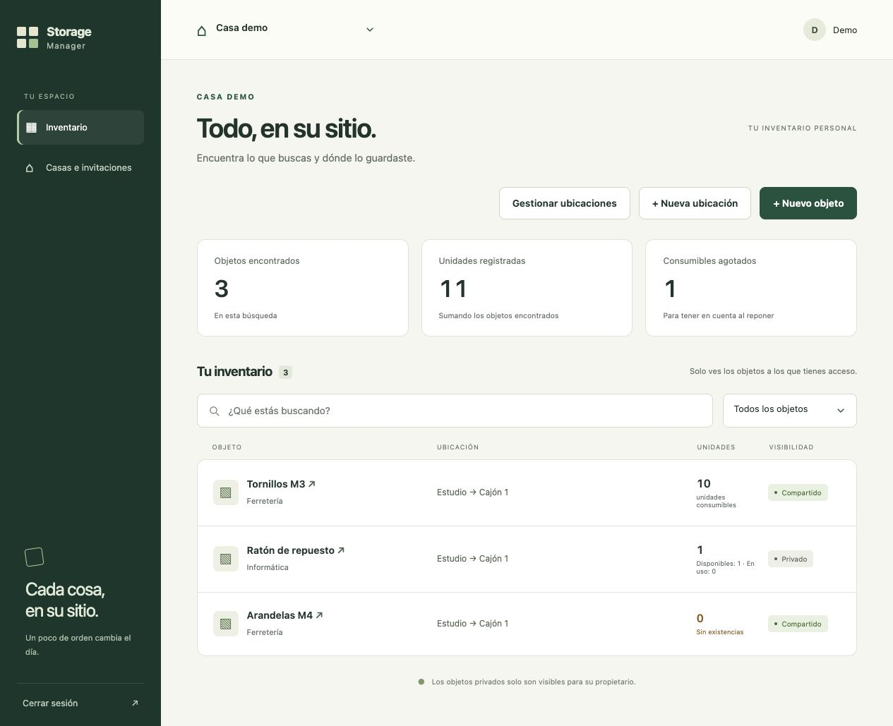
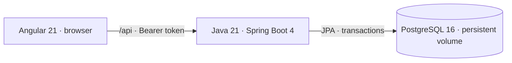

# Storage Manager

Find what you stored, where you put it, and whether it is available.

Storage Manager is a household inventory app built with **Angular, Java/Spring Boot
and PostgreSQL**. It started from a practical problem: keeping drone parts,
batteries, controllers and other equipment across drawers without losing track
of their location. The same workflow applies to tools and everyday household items.

The MVP is functional and in a small feedback beta. The current focus is fixing
reported issues and validating the main workflows, rather than adding features.



[Mobile screenshot](docs/images/inventory-mobile.jpg) · All screenshots use fictitious data.

## Try it

- **Interview walkthrough:** [five-minute demo and Spanish speaking script](docs/local-demo.md).
- **Shared beta:** HTTPS access is available on request with individual test accounts.
  It runs on the developer's Mac through Tailscale Funnel, so availability depends
  on the Mac, Docker and connection. Public registration is closed; no credentials
  are included in this repository.
- **Reproducible local setup:** run web, API and PostgreSQL with Docker Compose below.
  No paid hosting or separate Node server is required.

## What the MVP does

- Organize houses and nested locations; invite another account to a house.
- Search by name and direct location, with visibility/type/availability filters.
- Consume part of a quantity and replenish units, preserving their histories.
- Track an individual reusable object or a group through withdrawal and return.
- Move objects within a house and inspect movement history.
- Keep objects private or explicitly share them with house members; the API enforces access.
- Archive and restore records. Permanent item deletion also removes its histories;
  deleting a location retains its objects as unassigned.
- Export the visible inventory to CSV, check remote data changes and offer a manual
  reload when a new frontend version is published.

The interface adapts to desktop and narrow screens. The app includes a web manifest
and icons for installation testing; it requires a connection and does not provide
offline inventory. Real Android validation remains pending.

## Run locally

Prerequisite: Docker with Docker Compose. Java and Node build tools run inside the image.

```bash
cp .env.example .env
```

Replace the database-password and JWT-secret placeholders in `.env` with your own
random values. Use a JWT secret of at least 32 characters. Keep the file out of Git.
Then start the application:

```bash
docker compose up --build
```

Open http://localhost:8080. Create a local account and a house to start with an empty
inventory. Swagger is at http://localhost:8080/swagger-ui/index.html in the normal
local profile. Web and database ports bind to localhost by default.

The `storage-data` volume persists data across container recreation. Do not remove
volumes to update the app. Use the same Compose project name and environment file
when returning to an existing instance. [Backups and isolated recovery checks](docs/local-backups.md).

For development outside Docker: Java 21, the Maven Wrapper and PostgreSQL 16 for the
API; a supported Node version for Angular. Configure `SPRING_DATASOURCE_URL`,
`SPRING_DATASOURCE_USERNAME`, `SPRING_DATASOURCE_PASSWORD` and `JWT_SECRET`, then run
`./mvnw spring-boot:run`. See [frontend development](frontend/README.md).

## Architecture and decisions



Docker packages the compiled Angular app into the Spring Boot application. The
backend uses controllers, validated request/response DTOs, services and repositories.
Spring Security handles JWT authentication; passwords use BCrypt.

- **One monolith:** one deployable app and database keep a small project easier to
  run, debug and explain. Microservices are outside the MVP.
- **Explicit inventory operations:** consuming, replenishing, moving and returning
  have different rules and histories instead of being generic quantity edits.
- **Transactional writes:** the inventory change and its history are stored together.
  A house-level lock serializes writes within one house, trading throughput for
  simpler consistency. Different houses do not share that lock.
- **One current location, optionally absent:** an object is not split across
  locations. Deleting its location leaves it unassigned in the same house.
- **Server-side permissions:** identity comes from the verified session, and DTOs
  keep persistence relationships and password hashes out of responses. An Angular
  route guard or a hidden button is not treated as authorization.

## Verification

Latest recorded runs before this documentation review: **164 Java tests and
123 Angular tests**, plus a production build. These counts describe the recorded
5 November 2026 runs, not a claim that every device or security scenario is covered.

The suites cover validation, authorization between accounts, inventory operations,
transaction rollback/concurrency cases and UI behavior. PostgreSQL/Docker checks use
an isolated disposable project to verify persistence and recovery without using
personal inventory.

```bash
./mvnw verify
cd frontend
npm test
npm run build
```

The complete local pipeline is `./scripts/verify_local.sh`; it also runs Python
backup tests and Docker/PostgreSQL verification. The GitHub workflow is manual,
with no automatic deployment. [Verification details](docs/verification.md).

## Security and practical limits

The beta uses HTTPS, a separate database and secrets, closed registration, CSP and
login rate limits. Private objects are inaccessible to other app accounts even if
they belong to the same house. Location names remain shared within that house.

Inventory is **not end-to-end encrypted**: the database operator and readable
backups can access stored fields. Browser-held JWTs are not HttpOnly cookies.
This is a small beta, not a production availability or DDoS-protection guarantee.
See [security boundaries](docs/security-and-storage.md) and
[beta configuration](docs/private-beta-security.md).

Real Android/installation checks, large-inventory pagination and a versioned schema
migration strategy remain areas for further work. Photos, multi-location quantities,
PDF export and microservices are outside the current MVP. No intentional bugs are
introduced in the main branch.

## Technical reference

- [REST endpoints and authentication examples](docs/api-reference.md)
- [Item types and quantities](docs/item-kinds.md) · [Reusable usage](docs/reusable-usage.md)
- [Privacy and movements](docs/item-privacy.md) · [Deletion rules](docs/item-deletion.md)
- [Packaging and routing](docs/docker-web.md) · [HTTPS beta setup](docs/https-funnel.md)
- [CSV export](docs/inventory-csv.md) · [Dependency review](docs/dependency-review.md)
- [MVP scope and current priorities](docs/demo-plan.md)
